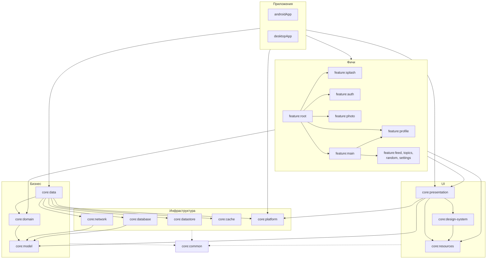

# Архитектура: модули и платформы

Где что лежит и какой модуль от какого зависит. Что такое каждый слой и кто кого вызывает — `architecture/layers.md`.

Related: `setup/gradle-conventions.md`, `architecture/data.md`.

## Модули

| Модуль | Роль |
|---|---|
| `androidApp`, `desktopApp` | Точки входа платформ: окно или `Application`, старт Koin (`@KoinApplication`), создание корневого компонента. Список модулей графа им даёт `applyAppGraph()` в `build-logic` |
| `feature:root` | Корневой граф: сплэш, вход, фото и чужой профиль поверх вкладок, снекбары; `RootGraphUi(component)` — корневой экран, тему вокруг него задают приложения |
| `feature:main` | Граф вкладок вошедшего пользователя: лента, подборки, случайные, студия, настройки |
| `feature:splash`, `feature:auth` | Экраны; `feature:auth` — экран входа, показывается, пока нет сессии |
| `feature:feed`, `feature:topics`, `feature:random`, `feature:profile`, `feature:settings` | Вкладки основной навигации; `feature:profile` также открывается над навигацией как чужой профиль |
| `feature:photo` | Детали фото: EXIF, статистика, коллекции пользователя, скачивание |
| `core:presentation` | Базовые классы экрана, общие UI-блоки с логикой (шторка, сообщение об ошибке запроса, уведомления, разрешения) |
| `core:design-system` | Тема, токены, компоненты без бизнес-логики |
| `core:resources` | Единственное место ресурсов: строки (по областям), шрифты, картинки; публичный `Res` |
| `core:domain` | Интерфейсы репозиториев, use case'ы |
| `core:data` | Реализации репозиториев, сессия, скачивание файлов |
| `core:model` | Чистые `@Serializable` модели |
| `core:network` | Ktor-клиент, `Response`-обёртка запросов, API-классы, модели запросов и ответов с мапперами в доменные модели, мониторинг сети |
| `core:database`, `core:datastore`, `core:cache` | Room (кэш данных), DataStore, каталог для скачанных файлов |
| `core:platform` | `expect`/`actual`: диспетчеры, время, язык, буфер обмена, переходы по системным ссылкам |
| `core:common` | Без зависимостей на другие `core`: `Response`, `AppDispatchers`, пагинация, расширения, flow-утилиты |

## Граф зависимостей

Стрелка идёт от модуля к тому, от кого он зависит. Каждый `core`-модуль может зависеть от `core:common` (не нарисовано).
Feature-модули получают `common`, `model`, `domain`, `presentation`, `design-system`, `resources` от плагина
`wallify.feature`.

## Правила зависимостей

1. `core:common`, `core:model` ни от чего не зависят (кроме библиотек). `core:model` — только данные, без логики и UI.
2. `core:domain` зависит от `core:model` и `core:common`, не знает про `core:data`, сеть, базу и UI.
   `core:presentation` зависит от `core:model`: `XxxUi` мапится в доменный enum рядом с собой (`toDomain()`,
   обратно `toPresentation()`). `core:model` про UI не знает.
3. Реализации (`core:data`) знают про `domain` и инфраструктуру; обратной зависимости нет.
   `core:network` зависит от `core:model`: модель ответа API мапится в доменную рядом с собой (`toDomain()`),
   `core:model` про сеть не знает. Так же `core:database` зависит от `core:model`: сущность Room мапится в доменную
   модель и обратно рядом с собой (`toEntity()` / `toDomain()`), `core:model` про базу не знает.
4. Feature-модули не зависят друг от друга, кроме двух графов: `feature:main` собирает вкладки, `feature:root`
   собирает сплэш, вход, фото, чужой профиль и `feature:main`.
   `core:design-system` берёт из `core:resources` шрифт темы и общие тексты своих компонентов (состояния списка
   фото); обратной зависимости нет.
5. Приложения зависят от всех модулей с Koin-привязками (список в `build-logic`, `applyAppGraph()`), чтобы собрать
   граф; в коде приложения используют только `feature:root`, `design-system` (тема) и `core:resources` (строки).
6. Новая зависимость, которая добавляет стрелку против этого графа, — повод остановиться и спросить.

## Платформы

- Поддерживаются Android и Desktop (JVM). iOS-таргетов нет; добавлять их без просьбы не нужно.
- В `commonMain` — только мультиплатформенные API: `kotlin.*`, `kotlinx.*`, Compose Multiplatform, Ktor, Room KMP,
  Koin. Без `android.*`, `java.*`, `javax.*`.
- Платформенная реализация — `expect`/`actual` в одном модуле (`core:platform`, `core:cache`, `core:datastore`,
  `core:database`, `core:network`): интерфейс или `expect` в `commonMain`, реализации в `androidMain` и `jvmMain`.
- Если `androidMain` и `jvmMain` нужен один и тот же JVM-код, пока допустимо небольшое дублирование; общий
  промежуточный source set заводится только по просьбе.
- `TODO` и `return null` вместо реализации на одной из платформ не оставляем.